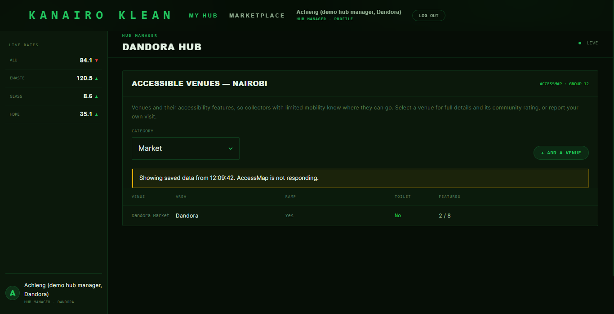

# RESILIENCE NOTES

## Part A - Before resilience

- Normal speed=0.006792 seconds
- Slow mode on=10.290939 seconds
-The 3rd attempt was OK the first two were bad gateways 502

## Part B — Timeout Implementation

- Timeout value chosen: 1500 ms
- Justification: A healthy local API call finishes in under 50 ms. 1500 ms provides sufficient buffer for minor network jitter while ensuring requests fail fast before the user gives up or browser default timeouts kick in.
- Proven duration in slow mode: ~1.5s

## Part C — Retry Logic

`server/resilientFetch.js` (`fetchWithRetry`). Every call to Group 12 goes through it, via `callPartner()` in `server/app.js`.

| Situation | Retried? |
| --- | --- |
| Timeout or failed connection | Yes |
| 429, 500, 502, 503, 504 | Yes. For a 429 we wait the partner's `Retry-After`, up to 5 s |
| 400, 401, 403, 404 and other 4xx | No: the request is wrong, so asking again changes nothing |
| POST (adding a venue, sending a report) | No, never: a retry could create it twice |

- **Numbers:** timeout 1500 ms, at most **2 retries**, waits of **200 ms, then 400 ms**. They can be changed in `.env` (`PARTNER_TIMEOUT_MS`, `PARTNER_RETRIES`, `PARTNER_RETRY_DELAY_MS`).
- **Worst-case wait:** (2 + 1) × 1500 + 200 + 400 = **5100 ms**. Measured on the slow stand-in: **5.14 s**.
- **Is 5 seconds acceptable?** Yes for this feature. The Accessible Venues panel is one card on the hub page, and it loads separately from everything else. The hub manager's queues, stock and charts appear at once, and only this card waits.
- **Real partner timing:** Group 12 (on Render) usually answers in about **0.4 s** (measured 0.39 to 0.49 s). The first call after a quiet spell took **1.37 s**, close to the timeout, so occasionally a first attempt times out and the retry gets the answer. If Render has fully put their server to sleep (it takes about 30 s or more to wake), all three attempts time out and the saved copy from Part D is used.

**Proof (our server pointed at `server/flaky-partner.js`).**

Flaky mode: the page succeeds, and the log shows exactly two retries:

```
GET partner /api/venues?category=market: attempt 1 failed (status 503), retrying in 200 ms
GET partner /api/venues?category=market: attempt 2 failed (status 503), retrying in 400 ms
GET /partner/venues?category=market -> 200
```

Error mode (always 500): exactly two retries, then it stops. No infinite loop:

```
GET partner /api/venues?category=market: attempt 1 failed (status 500), retrying in 200 ms
GET partner /api/venues?category=market: attempt 2 failed (status 500), retrying in 400 ms
partner call failed (status 500); serving market venues saved at 2026-10-30T09:08:36.979Z
```

The stand-in's own terminal showed `call 1`, `call 2`, `call 3` for each page load: at most three hits, never a flood.

The automated tests are in `server/__tests__/resilience.test.js`. They check: flaky → 3 calls then 200; error → exactly 3 calls; 404 → 1 call; POST on 503 → 1 call; slow → cut off at the timeout each time; 429 → waits for Retry-After.

## Part D — Graceful Fallback

- **Server.** `GET /partner/venues` (the Accessible Venues panel on the hub page) keeps the **last good list for each category in memory**. It answers with `{ data, stale, asOf }`:
  - Group 12 answered: `stale: false`, live data, saved for later.
  - Group 12 failed after the retries: `stale: true`, with the saved list and the time it was saved.
  - Group 12 failed and nothing is saved (for example after a restart): the friendly `502 {"code":502,"message":"Partner data unavailable"}`.
- **Client.** `client/src/components/PartnerVenues.jsx` reads `stale` and `asOf`, and shows a yellow banner: **"Showing saved data from 12:09:42. AccessMap is not responding."** With nothing saved, it shows "AccessMap data is unavailable right now. Try again in a minute; the rest of the dashboard still works."
- **The log still records every failure** (for example `partner call failed (status 500); serving market venues saved at …`). So if the real cause is our key being refused (401), the saved copy doesn't hide it from us.
- **Hub recommendations** use the same idea. Their copy of AccessMap's venue list is refreshed once a day. If a refresh fails, the previous list is kept, so the accessibility ranking still works with older data instead of switching off.

| Stand-in mode | What the hub manager sees | Time |
| --- | --- | --- |
| ok | Live venue list, no banner | 0.09 s |
| error (always 500) | The same list, with the saved-data banner | 0.6 s |
| slow (10 s answers) | The same list, with the saved-data banner | 5.1 s |
| slow, nothing saved yet (another category, or after a restart) | "AccessMap data is unavailable right now. Try again in a minute." | 5.1 s |
| back to ok | Live data, banner gone, no code changed | 0.09 s |

Screenshot of the fallback, with the partner intentionally failing: [`screenshots/week11-saved-data-banner.png`](screenshots/week11-saved-data-banner.png)



The saved copy lives in memory, so it disappears when the server restarts. That's fine for this course; production would keep it in a cache or the database.
